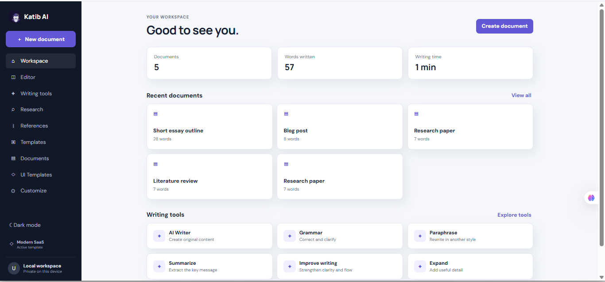
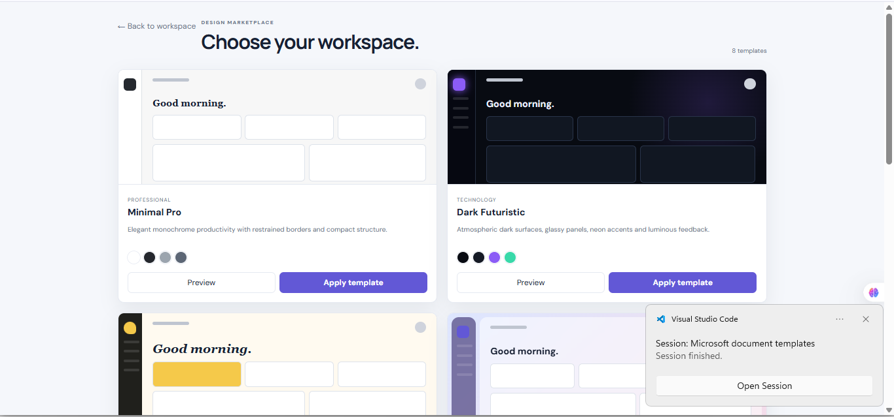
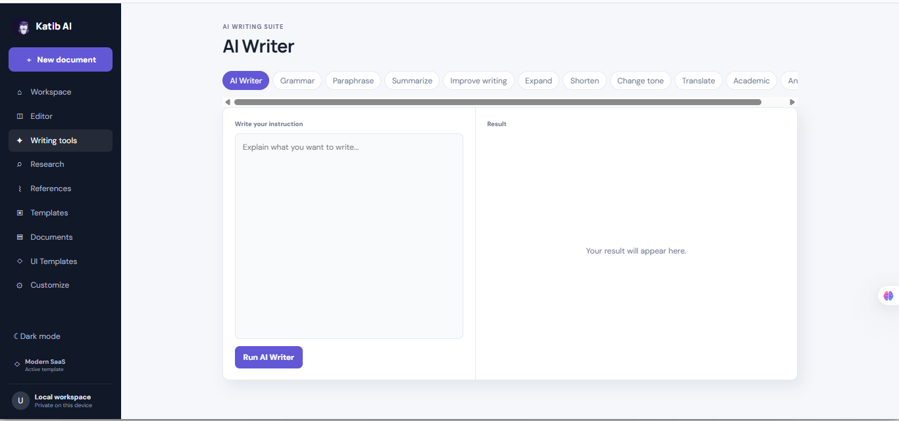

# Katib AI

Katib AI is a responsive AI-powered writing, editing, and academic research workspace built with Next.js. It combines a rich-text document editor, local document management, AI writing tools, research assistance, citation management, file processing, and customizable interfaces in one application.


## Highlights

- Rich-text document editor with formatting, word count, reading time, and document-wide editing
- Automatic and manual document saving
- Document creation, renaming, duplication, favorites, archiving, deletion, restore, search, and version history
- AI writing tools for generation, grammar, rewriting, paraphrasing, summarization, tone, translation, expansion, shortening, and analysis
- Selection-aware AI editing
- Research Workspace for papers, literature reviews, thesis planning, proposals, abstracts, and research-gap analysis
- Local reference and bibliography manager
- PDF, DOCX, TXT, and Markdown text import
- TXT, Markdown, HTML, DOCX, and print-to-PDF export
- Eight built-in UI templates with live previews and persistent appearance customization
- Light, dark, and system theme modes
- Responsive desktop, tablet, and mobile layouts
- Reduced-motion support
## Screenshot






## Application areas

### Workspace

The home workspace displays local writing activity and recent documents. It provides quick access to document creation and the most-used AI tools.

### Documents

Documents are managed in the local document library. Supported workflows include:

- Create and edit documents
- Rename titles
- Duplicate documents
- Add and remove favorites
- Archive documents
- Move documents to Deleted
- Restore deleted documents
- Search document titles and content
- View and restore saved versions

### Editor

The editor includes bold, italic, underline, headings, lists, and text selection for AI processing. Selecting text and choosing the AI action sends the selection to the AI panel for controlled review and insertion.

### AI Writing

The writing suite uses the server-side `/api/generate` route. It does not return simulated AI responses when a provider is unavailable.

### Research Workspace

Open `http://localhost:3000/research` for evidence-focused academic assistance. The workspace supports:

- Research paper section planning
- Literature review synthesis
- Thesis chapter planning
- Research proposal structure
- Abstract generation
- Research-gap analysis

The research prompts require supplied context and instruct the model not to invent references, DOI values, datasets, quotations, findings, or citations.

### Citation Manager

Open `http://localhost:3000/citations` to manage references locally. It supports basic manual entry and APA 7, IEEE, and MLA formatting. Metadata must be verified before citation.

### Document templates

Open `http://localhost:3000/settings/templates` to browse the eight UI themes:

1. Minimal Pro
2. Dark Futuristic
3. Creative Studio
4. Glassmorphism
5. Modern SaaS
6. Academic Ivory
7. Midnight Indigo
8. Warm Editorial

The document Templates view also includes editable structures inspired by Microsoft Word learning resources:

- Thesis format
- Student academic self-assessment
- Course syllabus
- Science fair planner
- Short essay outline
- Grading rubric

Links to the official Microsoft Word templates are provided for editing in Microsoft Word.

## Technology

- Next.js 13 Pages Router
- React 18
- OpenAI Node.js SDK
- Mammoth for DOCX text extraction
- pdf-parse for PDF text extraction
- docx for DOCX export
- Browser `localStorage`
- Framer Motion dependency for UI motion integration

## Requirements

- Node.js 18 or newer
- npm
- An OpenAI API key for real AI responses

## Installation

Install dependencies:

```bash
npm install
```

Copy the environment template:

```bash
cp .env.example .env.local
```

On Windows Command Prompt:

```bat
copy .env.example .env.local
```

Configure the server-side AI provider:

```env
OPENAI_API_KEY=your_api_key
OPENAI_MODEL=gpt-4o-mini
```

Use a model available to the configured OpenAI account. Do not add the API key to `NEXT_PUBLIC_*` variables or expose it in client code.

## Development

Start the development server:

```bash
npm run dev
```

Open `http://localhost:3000`.

Run lint checks:

```bash
npm run lint
```

Create a production build:

```bash
npm run build
```

Start the production build:

```bash
npm start
```

## API routes

### `POST /api/generate`

Generates AI text on the server.

Example:

```json
{
  "action": "rewrite",
  "text": "Text to improve",
  "tone": "Professional",
  "language": "English"
}
```

The route validates methods and input, limits text length, applies an in-memory rate limit, uses a timeout, and returns configuration or provider errors instead of fabricated output.

### `POST /api/extract-document`

Extracts text from PDF, DOCX, TXT, or Markdown uploads. Requests are limited to 10 MB per file.

Scanned PDFs may require external OCR because this route does not perform optical character recognition.

### `POST /api/export-docx`

Creates a DOCX file from a document title and HTML content.

## Data and privacy

The current implementation is local-first:

- Documents are stored in browser `localStorage`
- Theme and customization preferences are stored in browser `localStorage`
- References are stored in browser `localStorage`
- No account or server-side document database is included
- Clearing browser storage removes local documents, preferences, and references

The UI should not be considered a multi-user secure document system until authentication and server-side database persistence are implemented.

## Docker

The included Compose configuration exposes the application on port 3001:

```bash
docker compose up --build
```

Open `http://localhost:3001`.

Set `OPENAI_API_KEY` in `docker-compose.yml` or replace it with a deployment secrets mechanism before using AI generation. The example key must not be committed to source control.

## Theme customization

Use the **Customize** control in the sidebar to change:

- Light, dark, or system appearance
- Primary and UI colors
- Typography
- Heading and body size
- Sidebar, spacing, and radius
- Border and shadow intensity
- Animation level

Theme preferences are applied across the main workspace, research pages, citation pages, editor, dialogs, and template gallery.

## Accessibility

- Semantic labels and dialogs are used for primary controls
- Keyboard-focusable controls are retained across navigation
- Responsive sidebar and mobile navigation are included
- Reduced-motion browser preferences disable interface animation
- Text contrast should be reviewed when custom colors are used

## Testing and validation

Before deployment, verify:

1. Create, edit, search, duplicate, favorite, archive, delete, and restore documents
2. Reload the page and confirm autosaved local documents return
3. Restore an earlier document version
4. Run AI tools with and without `OPENAI_API_KEY`
5. Upload PDF, DOCX, TXT, and Markdown files
6. Export TXT, Markdown, HTML, DOCX, and PDF
7. Apply all eight UI templates
8. Switch light, dark, and system modes
9. Open and use the research and citation pages
10. Check desktop, tablet, and mobile layouts

Commands:

```bash
npm run lint
npm run build
```

## Current limitations

- No authentication or server-side user isolation
- No PostgreSQL, Supabase, MongoDB, or other production database integration
- Documents and references remain device/browser local
- PDF OCR is not included
- Bibliography metadata is not automatically verified
- Microsoft Word template links open external Word pages; only local editable structure examples are created inside Katib
- The AI API rate limit is process-memory based and resets on server restart
- Upload text extraction is server-based and should be restricted by production infrastructure controls

## Deployment notes

Before production deployment:

- Add authentication and server-side data persistence
- Store API keys and secrets in a deployment secret manager
- Replace in-memory rate limiting with Redis or provider-level rate limiting
- Add upload malware scanning and content limits
- Configure HTTPS and secure browser storage policies
- Add database backups and document migration
- Use a production-supported OpenAI model
- Run lint, build, security, and responsive tests
